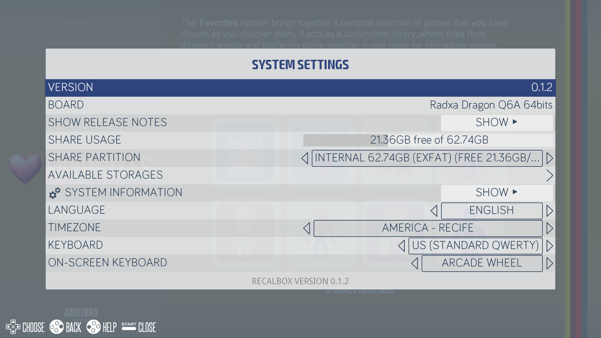
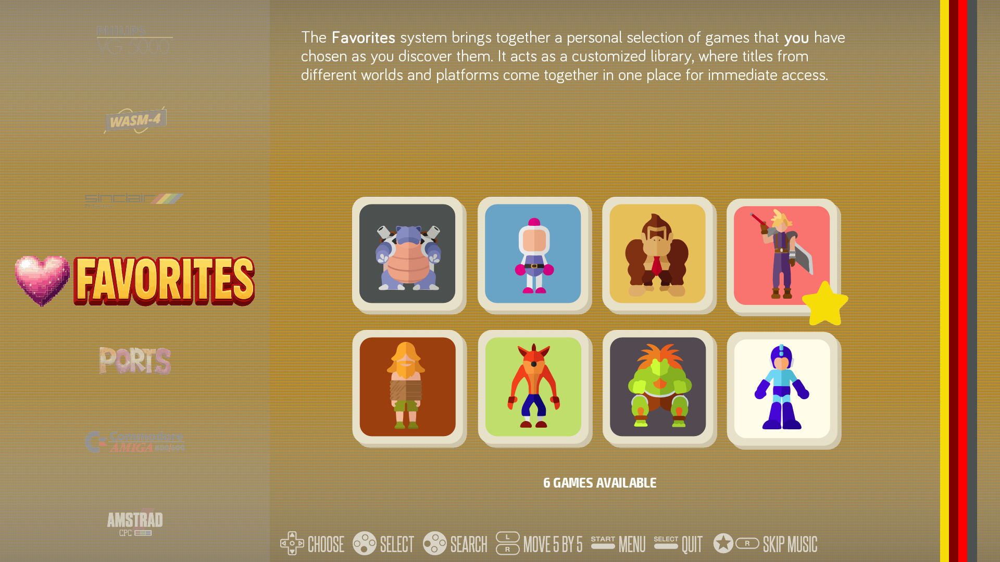

# Recalbox for the Radxa Dragon Q6A

Port of [Recalbox](https://gitlab.com/recalbox/recalbox) (the Buildroot-based retro-gaming OS) to the
[Radxa Dragon Q6A](https://docs.radxa.com/en/dragon/q6a) (Qualcomm QCS6490: 4x Cortex-A78 + 4x Cortex-A55, Adreno 643).
Boots straight into EmulationStation from a USB 3.0 / SATA SSD or from the internal NVMe, with video, audio, Wi-Fi and
Bluetooth working, on a mainline Linux 7.2.9 kernel.

Sibling project of [ubuntu-26.04.1-dragon-q6a](https://github.com/rafaelwms/ubuntu-26.04.1-dragon-q6a), which provided the
hardware recipe (firmware, audio UCM, AIC8800 Wi-Fi/BT).

> **Unofficial community port** — not affiliated with or supported by the Recalbox team, Radxa or Qualcomm; non-commercial use only (see [NOTICE.md](NOTICE.md)).
> **Port não oficial da comunidade** — sem vínculo ou suporte da equipe do Recalbox, da Radxa ou da Qualcomm; somente uso não comercial (veja o [NOTICE.md](NOTICE.md)).

🇧🇷 **[Leia em português mais abaixo](#português)**

---

## English

### Screenshots

Captured on a Radxa Dragon Q6A running this image (v0.1.2), straight from the HDMI output.





### What works

| | Status |
|---|---|
| Boot (UEFI + GRUB), EmulationStation | ✅ |
| HDMI video | ✅ (see the resolution note below) |
| Audio: HDMI **and** 3.5 mm headphone jack | ✅ |
| Wi-Fi (onboard AIC8800) | ✅ |
| Bluetooth: speakers/headphones and gamepads | ✅ |
| USB gamepads, keyboard, mouse | ✅ |
| Gigabit Ethernet | ✅ |
| Emulators and PC ports included in the image | ✅ all opened and run on real hardware; **PS1** (`pcsx_rearmed`) and **Dreamcast** (`flycast`) tested in particular |

### Known limitations

- **The HDMI output is limited to 4K@30 Hz** by the hardware ([Radxa specs](https://docs.radxa.com/en/dragon/q6a)). A 4K TV
  that advertises 4K as its preferred mode used to make Recalbox pick it, halving the speed of 60 fps games (slow motion and
  wobbling audio). Since v0.1.1 the kernel **hides modes above 1440p, modes wider than 1080p above 60 Hz, and modes below 50 Hz**,
  and the default video mode is 1080p. See [Display modes](#display-modes-and-tuning) to change the limits.
- A few seconds of white screen at boot, while the GPU firmware loads. Cosmetic.
- **A game can freeze on its very first frame** (for example the MAME "Copyright Warning" screen) with no CPU use. Cause: sometimes the
  audio DSP fails to start the HDMI audio port (kernel: `Failed to start APM port 104 ... DISPLAY_PORT_RX_0`); PulseAudio still reports the
  sink as running, nothing consumes the audio and the emulator waits for it forever. Cycling the sink (`pactl suspend-sink <HDMI sink> 1`,
  then `0`) makes it resume instantly. [`extras/q6a-audiofix.sh`](extras/q6a-audiofix.sh) does this automatically, see
  [Troubleshooting](#troubleshooting). It will be built into the next release.
- Not included yet: Kodi, Vulkan (Turnip is not in this Buildroot), and a few minor cores (`vircon32`, `flycast-next`).
- Power: the board can brown out under heavy NVMe + USB load. Use a good USB-C PD supply.

See [docs/PLAN.md](docs/PLAN.md) for the full status log, the dead ends and the roadmap.

### Display modes and tuning

The kernel limits the modes the HDMI output exposes (so the board never ends up at 4K@30 by accident). The limits are kernel
parameters; to change them edit `grub.cfg` on the boot partition (the `RECALBOX` FAT partition, `boot/grub/grub.cfg`) and add them
to the `linux` line:

| Parameter | Default | Meaning |
|---|---|---|
| `msm.dp_max_width` / `msm.dp_max_height` | 2560 / 1440 | hide larger modes (0 = no limit) |
| `msm.dp_hires_max_refresh` | 60 | hide modes wider than 1920 above this refresh rate |
| `msm.dp_min_refresh` | 50 | hide modes of 1280 pixels or more below this refresh rate (24/25/30 Hz) |

Set `global.videomode` (and `system.es.videomode`) in `recalbox.conf`, or use *Menu → System settings → Video*. Other options in
`recalbox.conf` (commented out by default):

- `system.cpu.governor=performance` keeps the CPU at full speed: steadier frame times and less input jitter, a bit more power and heat.
- `global.runahead=1` and `global.reducelatency=1` lower input latency on 8/16-bit systems (NES, SNES, Mega Drive, Master System,
  Game Boy, Game Gear, FBNeo). If your TV has a game mode (ALLM / "Game Optimizer"), turn it on: it is the biggest single factor.
- Official Recalbox updates are **disabled** (`updates.enabled=0`): they would install an image that does not run on this board.
  Update by flashing a new release, or by replacing `boot/linux`, `boot/initrd.gz` and `boot/recalbox` on the boot partition.

### Troubleshooting

**A game freezes on its first frame / the frontend hangs after leaving a game.** Since **v0.1.2** the image ships the HDMI audio self-heal watcher
(`/usr/bin/q6a-audiofix`, started at boot, log in `/recalbox/share/system/logs/q6a-audiofix.log`); nothing to install. Turn it off with
`q6a.audiofix=0` in `recalbox.conf`. On **v0.1.0 / v0.1.1** copy the two files in [`extras/`](extras) to `/recalbox/share/system/` (SSH `root`, or the
`share` network share) as `q6a-audiofix.sh` and `custom.sh` (rename `q6a-diag-custom.sh`) and reboot. If you upgrade from those versions to v0.1.2,
**delete that `custom.sh`**: the image now does the same by itself.

**Bug reports.** v0.1.2 keeps a kernel log and a 5-second heartbeat in `/recalbox/share/system/logs/q6a-kernel.log` (current boot and the two previous
ones, at most 50 MB each; `q6a.diaglog=0` disables it). Please attach it, plus `frontend.log` from the same folder, to the issue. They contain no passwords;
the `frontend.log` does contain the names of your ROM files and a device UUID, so skim it first.

**The Output Device list had 4 entries and sliding the volume could restart the frontend.** Fixed in v0.1.2 (upstream EmulationStation bugs,
[`patches/0008`](patches/0008-fix-es-list-each-sound-card-s-ports-once-and-lock-th.patch)).

### Install a pre-built image

**1. Pick the storage** (the installer erases it completely and writes the whole image; the `SHARE` and `OVERLAY` partitions are created in the free space on first boot):

| Medium | Status | Notes |
|---|---|---|
| USB 3.0 SSD / SATA SSD in a USB case | ✅ tested | Best choice for an external drive. |
| NVMe SSD in a USB NVMe case, or the board's internal M.2 NVMe | ✅ tested | Flash it from your computer in the USB case, then move it to the board's M.2 slot; or see [the NVMe guide](#install-on-the-internal-nvme-next-to-other-systems) to keep other systems. |
| microSD card | ⚠️ not tested by the maintainer | Use a good card, ≥ 32 GB, A1/A2. Make sure your board firmware boots from the SD slot. |
| USB stick | ⚠️ not tested by the maintainer | Use a USB 3.0 stick ≥ 32 GB; slow sticks make the menus and saves sluggish. |

The image needs about 5 GiB; any medium of **16 GB or more** works, **32 GB or more** leaves room for ROMs in `SHARE`.

**2. Download** [Releases](../../releases): **all** `.part*` files plus the two `SHA256SUMS-*.txt` files (or let the installer download them), then run the
installer for your OS. Each one verifies the checksums, reassembles and unpacks the image and flashes it, asking you to type the exact target disk and a
confirmation word before it writes anything. English and Brazilian Portuguese are both offered.

| OS | Command | Needs |
|---|---|---|
| **Linux** | `./install.sh` | `curl`, `xz`, `sudo`, `lsblk` |
| **macOS** | `./install_mac.sh` | `curl`, `xz` (`brew install xz`), `sudo` |
| **Windows 10/11** | PowerShell **as Administrator**: `Set-ExecutionPolicy -Scope Process Bypass -Force; .\install.ps1` | [7-Zip](https://www.7-zip.org/) (`winget install 7zip.7zip`), ~6 GB free in `%TEMP%` |

> The Windows script follows the same flow as the Linux/macOS ones but, as of v0.1.2, the maintainer has not been able to run it on real Windows hardware: if it
> misbehaves, please open an issue and use the manual steps below.

**Or by hand.** Linux:

```bash
sha256sum -c SHA256SUMS-parts.txt --ignore-missing
cat recalbox-radxa-dragon-q6a_<version>.img.xz.part* > image.img.xz
sha256sum -c SHA256SUMS-full.txt --ignore-missing
xzcat image.img.xz | sudo dd of=/dev/YOUR_DEVICE bs=4M status=progress conv=fsync
```

macOS (`diskutil list` to find the disk, e.g. `disk4`):

```bash
shasum -a 256 -c SHA256SUMS-parts.txt          # lines for files you did not download are reported as missing
cat recalbox-radxa-dragon-q6a_<version>.img.xz.part* > image.img.xz
diskutil unmountDisk /dev/disk4
xzcat image.img.xz | sudo dd of=/dev/rdisk4 bs=4m && diskutil eject /dev/disk4
```

Windows (Command Prompt): `copy /b recalbox-radxa-dragon-q6a_<version>.img.xz.part* image.img.xz`, check it with `certutil -hashfile image.img.xz SHA256`
against `SHA256SUMS-full.txt`, unpack it with 7-Zip and write the `.img` with [Rufus](https://rufus.ie/) or [balenaEtcher](https://etcher.balena.io/).

⚠️ Triple-check the target (`lsblk`, `diskutil list`, Disk Management): this erases the whole device.

**3. Boot** the board from it (UEFI boot menu, or rEFInd). The **first boot takes 1–2 minutes**: Recalbox creates `SHARE` (exFAT) and `OVERLAY` (ext4).
Do not power off during this step. The default video mode is 1080p60.

**4.** SSH is enabled: user `root`, password `recalboxroot` (**change it** in `recalbox.conf`; optionally add your public key to
`/recalbox/share/system/.ssh/authorized_keys`).

### Install on the internal NVMe next to other systems

If the NVMe already holds other systems (e.g. Ubuntu, Windows) you do **not** need to erase it. Leave ≥ 8 GiB of free space at
the end of the disk, then add a 5 GiB boot partition there and copy the image's contents into it:

```bash
xzcat recalbox-radxa-dragon-q6a_<version>.img.xz > recalbox.img
sudo sgdisk -n 5:0:+5GiB -t 5:EF00 -c 5:boot /dev/nvme0n1     # adjust the partition number
sudo mkfs.vfat -F 32 -n RECALBOX /dev/nvme0n1p5
sudo losetup -rfP --show recalbox.img                          # prints /dev/loopN
sudo mount -o ro /dev/loopNp1 /mnt/img && sudo mount /dev/nvme0n1p5 /mnt/rb
sudo cp -r /mnt/img/. /mnt/rb/ && sync
```

Leave the rest unallocated: the first boot creates `SHARE` and `OVERLAY` there. rEFInd / the firmware lists the new entry
automatically. Boot partitions are found by the label `RECALBOX`: unplug any other disk carrying that label first.

### Build it yourself from source

This repository contains only the Q6A-specific delta; upstream Recalbox is cloned at the pinned commit recorded in `scripts/bootstrap.sh` (`27224c1`) and the
series in [`patches/`](patches) is applied on top. One command does everything (clone, patches, build, licence manifest, split release assets):

```bash
./scripts/build-all.sh v0.1.2   # ~90 min on 20 cores the first time; a few minutes afterwards (ccache). Output: release/v0.1.2/
```

Or step by step:

```bash
./scripts/bootstrap.sh
cd recalbox && make recalbox-q6a_defconfig && make -j"$(nproc)" && make legal-info
../scripts/make-release.sh v0.1.2 output/images/recalbox/recalbox-q6a.img.xz ../release/v0.1.2   # parts <= 1.4 GB + SHA-256 sums
```

Very new hosts (e.g. Ubuntu 26.04) need a few workarounds for the old Buildroot (GCC 14 for host tools via `HOSTCC14`/`HOSTCXX14`, CMake 3.31 in
`CMAKE3_BIN`, `CMAKE_POLICY_VERSION_MINIMUM=3.5`, `LC_ALL=C`, `TERM`, `dpkg-deb`, `rsync`, and `scripts/fetch_gitlab.py` for the
gitlab.com tarballs that return 403). They are listed in [docs/PLAN.md](docs/PLAN.md).

**Updating a running board without re-flashing:** copy `output/images/boot-data/boot/recalbox` to `/boot/boot/recalbox.new`
(remount `/boot` read-write; it only has room for two system files, so remove the oldest `recalbox.old` first), rename it over `recalbox` (keep the
old one as `recalbox.old`), check the `md5sum` and reboot. With an SSH key installed, send it straight from the build machine over SSH.

### Firmware and licences

This is an **unofficial, non-commercial** community port; read [NOTICE.md](NOTICE.md) and [LICENSE-RECALBOX.md](LICENSE-RECALBOX.md) before you redistribute anything.
The build downloads Radxa's firmware packages ([radxa-pkg](https://github.com/radxa-pkg): DSP firmware, AudioReach topology,
`alsa-ucm-conf`, AIC8800); they are proprietary, are not stored in this repository, and are included in the image. The `aic8800` driver is GPL-2.0.
Every release ships `q6a-legal-info_<version>.tar.gz` (licences and source list of every package, from Buildroot's `make legal-info`).

### Credits

🤖 Part of this project was built pair-programming with [Claude Code](https://claude.com/claude-code).

### License

The scripts, installers and documents in this repository are [MIT](LICENSE). The **image** is a derivative of Recalbox and is distributed under the
Recalbox licence: **non-commercial**, see [LICENSE-RECALBOX.md](LICENSE-RECALBOX.md) and [NOTICE.md](NOTICE.md). The emulators and other components keep their own licences.

---

## Português

### Capturas de tela

Capturadas numa Radxa Dragon Q6A rodando esta imagem (v0.1.2), direto da saída HDMI.


### O que funciona

| | Situação |
|---|---|
| Boot (UEFI + GRUB), EmulationStation | ✅ |
| Vídeo HDMI | ✅ (veja a nota de resolução abaixo) |
| Áudio: HDMI **e** conector de fone 3,5 mm | ✅ |
| Wi-Fi (AIC8800 onboard) | ✅ |
| Bluetooth: caixas/fones e controles | ✅ |
| Controles USB, teclado, mouse | ✅ |
| Ethernet Gigabit | ✅ |
| Emuladores e ports de PC incluídos na imagem | ✅ todos abertos e executados no hardware real; **PS1** (`pcsx_rearmed`) e **Dreamcast** (`flycast`) testados com atenção especial |

### Limitações conhecidas

- **A saída HDMI é limitada a 4K@30 Hz** pelo hardware ([especificações da Radxa](https://docs.radxa.com/en/dragon/q6a)). Uma TV 4K
  que anuncia o 4K como modo preferido fazia o Recalbox escolhê-lo, deixando os jogos de 60 fps na metade da velocidade (câmera
  lenta e áudio oscilando). Desde a v0.1.1 o kernel **esconde modos acima de 1440p, modos mais largos que 1080p acima de 60 Hz e
  modos abaixo de 50 Hz**, e o modo de vídeo padrão é 1080p. Veja [Modos de vídeo](#modos-de-vídeo-e-ajustes) para mudar os limites.
- Alguns segundos de tela branca no boot, enquanto o firmware da GPU carrega. Só estético.
- **Um jogo pode congelar já no primeiro quadro** (por exemplo na tela "Copyright Warning" do MAME), sem uso de CPU. Causa: às vezes o DSP de
  áudio falha ao iniciar a porta de áudio do HDMI (kernel: `Failed to start APM port 104 ... DISPLAY_PORT_RX_0`); o PulseAudio continua
  dizendo que o sink está rodando, ninguém consome o áudio e o emulador espera por ele para sempre. Suspender e retomar o sink
  (`pactl suspend-sink <sink HDMI> 1`, depois `0`) faz tudo voltar na hora. O [`extras/q6a-audiofix.sh`](extras/q6a-audiofix.sh) faz isso
  sozinho, veja [Solução de problemas](#solução-de-problemas). Vai vir embutido na próxima release.
- Ainda não incluídos: Kodi, Vulkan (o Turnip não existe neste Buildroot) e alguns núcleos menores (`vircon32`, `flycast-next`).
- Energia: a placa pode ter queda de tensão sob carga pesada de NVMe + USB. Use uma boa fonte USB-C PD.

Veja o [docs/PLAN.md](docs/PLAN.md) para o registro completo, os becos sem saída e o roteiro (em inglês).

### Modos de vídeo e ajustes

O kernel limita os modos que a saída HDMI expõe (assim a placa nunca cai no 4K@30 por acidente). Os limites são parâmetros do
kernel; para mudá-los, edite o `grub.cfg` da partição de boot (a partição FAT `RECALBOX`, `boot/grub/grub.cfg`) e acrescente à
linha `linux`:

| Parâmetro | Padrão | Significado |
|---|---|---|
| `msm.dp_max_width` / `msm.dp_max_height` | 2560 / 1440 | esconde modos maiores (0 = sem limite) |
| `msm.dp_hires_max_refresh` | 60 | esconde modos mais largos que 1920 acima dessa taxa de atualização |
| `msm.dp_min_refresh` | 50 | esconde modos de 1280 pixels ou mais abaixo dessa taxa (24/25/30 Hz) |

Defina `global.videomode` (e `system.es.videomode`) no `recalbox.conf`, ou use *Menu → Configurações do sistema → Vídeo*. Outras
opções do `recalbox.conf` (comentadas por padrão):

- `system.cpu.governor=performance` mantém a CPU em velocidade máxima: tempos de quadro mais estáveis e menos variação na entrada, com um pouco mais de consumo e calor.
- `global.runahead=1` e `global.reducelatency=1` reduzem a latência de entrada em sistemas de 8/16 bits (NES, SNES, Mega Drive,
  Master System, Game Boy, Game Gear, FBNeo). Se a sua TV tem modo jogo (ALLM / "Game Optimizer"), ligue: é o fator mais importante.
- As atualizações oficiais do Recalbox ficam **desligadas** (`updates.enabled=0`): instalariam uma imagem que não roda nesta placa.
  Atualize gravando uma nova release, ou trocando `boot/linux`, `boot/initrd.gz` e `boot/recalbox` na partição de boot.

### Solução de problemas

**Um jogo congela no primeiro quadro / o frontend trava depois de sair de um jogo.** Desde a **v0.1.2** a imagem traz o vigia de autocorreção do áudio HDMI
(`/usr/bin/q6a-audiofix`, iniciado no boot, log em `/recalbox/share/system/logs/q6a-audiofix.log`); não precisa instalar nada. Para desligar, use
`q6a.audiofix=0` no `recalbox.conf`. Na **v0.1.0 / v0.1.1**, copie os dois arquivos de [`extras/`](extras) para `/recalbox/share/system/` (SSH `root`, ou o
compartilhamento de rede `share`) como `q6a-audiofix.sh` e `custom.sh` (renomeie o `q6a-diag-custom.sh`) e reinicie. Se você atualizar dessas versões para a v0.1.2,
**apague esse `custom.sh`**: a imagem agora faz o mesmo sozinha.

**Relatos de bug.** A v0.1.2 guarda o log do kernel e uma pulsação de 5 s em `/recalbox/share/system/logs/q6a-kernel.log` (boot atual e os dois anteriores,
no máximo 50 MB cada; `q6a.diaglog=0` desliga). Anexe-o, junto com o `frontend.log` da mesma pasta, à issue. Não têm senhas; o `frontend.log` tem os nomes
dos seus arquivos de ROM e um UUID do aparelho, então dê uma olhada antes.

**A lista de Output Device mostrava 4 entradas e deslizar o volume podia reiniciar o frontend.** Corrigido na v0.1.2 (bugs do EmulationStation original,
[`patches/0008`](patches/0008-fix-es-list-each-sound-card-s-ports-once-and-lock-th.patch)).

### Instalar uma imagem pronta

**1. Escolha o armazenamento** (o instalador apaga tudo e grava a imagem inteira; as partições `SHARE` e `OVERLAY` são criadas no espaço livre no primeiro boot):

| Mídia | Situação | Observações |
|---|---|---|
| SSD USB 3.0 / SSD SATA em case USB | ✅ testado | Melhor escolha para um disco externo. |
| SSD NVMe em case USB NVMe, ou o NVMe M.2 interno da placa | ✅ testado | Grave pelo computador, no case USB, e depois passe para o slot M.2 da placa; ou veja [o guia do NVMe](#instalar-no-nvme-interno-junto-com-outros-sistemas) para manter outros sistemas. |
| Cartão microSD | ⚠️ não testado pelo mantenedor | Use um cartão bom, ≥ 32 GB, A1/A2. Confirme que o firmware da sua placa dá boot pelo slot SD. |
| Pendrive | ⚠️ não testado pelo mantenedor | Use um pendrive USB 3.0 ≥ 32 GB; pendrives lentos deixam menus e saves travando. |

A imagem ocupa cerca de 5 GiB; qualquer mídia de **16 GB ou mais** funciona, e **32 GB ou mais** deixa espaço para as ROMs no `SHARE`.

**2. Baixe** em [Releases](../../releases) **todos** os arquivos `.part*` mais os dois `SHA256SUMS-*.txt` (ou deixe o instalador baixar), e rode o instalador do
seu sistema. Cada um confere os checksums, reconstrói e descompacta a imagem e grava, pedindo que você digite o disco exato de destino e uma palavra de
confirmação antes de escrever qualquer coisa. Os dois oferecem inglês e português do Brasil.

| Sistema | Comando | Precisa de |
|---|---|---|
| **Linux** | `./install.sh` | `curl`, `xz`, `sudo`, `lsblk` |
| **macOS** | `./install_mac.sh` | `curl`, `xz` (`brew install xz`), `sudo` |
| **Windows 10/11** | PowerShell **como Administrador**: `Set-ExecutionPolicy -Scope Process Bypass -Force; .\install.ps1` | [7-Zip](https://www.7-zip.org/) (`winget install 7zip.7zip`), ~6 GB livres em `%TEMP%` |

> O script do Windows segue o mesmo fluxo dos de Linux/macOS mas, até a v0.1.2, o mantenedor não conseguiu rodá-lo num Windows real: se algo der errado,
> abra uma issue e use os passos manuais abaixo.

**Ou na mão.** Linux:

```bash
sha256sum -c SHA256SUMS-parts.txt --ignore-missing
cat recalbox-radxa-dragon-q6a_<versao>.img.xz.part* > imagem.img.xz
sha256sum -c SHA256SUMS-full.txt --ignore-missing
xzcat imagem.img.xz | sudo dd of=/dev/SEU_DISPOSITIVO bs=4M status=progress conv=fsync
```

macOS (`diskutil list` para achar o disco, ex.: `disk4`):

```bash
shasum -a 256 -c SHA256SUMS-parts.txt          # linhas de arquivos que você não baixou aparecem como ausentes
cat recalbox-radxa-dragon-q6a_<versao>.img.xz.part* > imagem.img.xz
diskutil unmountDisk /dev/disk4
xzcat imagem.img.xz | sudo dd of=/dev/rdisk4 bs=4m && diskutil eject /dev/disk4
```

Windows (Prompt de Comando): `copy /b recalbox-radxa-dragon-q6a_<versao>.img.xz.part* imagem.img.xz`, confira com `certutil -hashfile imagem.img.xz SHA256`
contra o `SHA256SUMS-full.txt`, descompacte com o 7-Zip e grave o `.img` com o [Rufus](https://rufus.ie/) ou o [balenaEtcher](https://etcher.balena.io/).

⚠️ Confira o destino com muito cuidado (`lsblk`, `diskutil list`, Gerenciamento de Disco): isso apaga o dispositivo inteiro.

**3. Dê boot** na placa por ele (menu de boot do UEFI, ou rEFInd). O **primeiro boot leva 1–2 minutos**: o Recalbox cria `SHARE` (exFAT) e `OVERLAY` (ext4).
Não desligue durante essa etapa. O modo de vídeo padrão é 1080p60.

**4.** O SSH vem ligado: usuário `root`, senha `recalboxroot` (**troque** no `recalbox.conf`; se quiser, ponha sua chave pública em
`/recalbox/share/system/.ssh/authorized_keys`).

### Instalar no NVMe interno junto com outros sistemas

Se o NVMe já tem outros sistemas (Ubuntu, Windows...), você **não** precisa apagar nada. Deixe ≥ 8 GiB livres no fim do disco,
crie ali uma partição de boot de 5 GiB e copie o conteúdo da imagem pra ela:

```bash
xzcat recalbox-radxa-dragon-q6a_<versao>.img.xz > recalbox.img
sudo sgdisk -n 5:0:+5GiB -t 5:EF00 -c 5:boot /dev/nvme0n1     # ajuste o número da partição
sudo mkfs.vfat -F 32 -n RECALBOX /dev/nvme0n1p5
sudo losetup -rfP --show recalbox.img                          # imprime /dev/loopN
sudo mount -o ro /dev/loopNp1 /mnt/img && sudo mount /dev/nvme0n1p5 /mnt/rb
sudo cp -r /mnt/img/. /mnt/rb/ && sync
```

Deixe o resto sem alocar: o primeiro boot cria o `SHARE` e o `OVERLAY` ali. O rEFInd / o firmware lista a nova entrada sozinho.
A partição de boot é encontrada pelo rótulo `RECALBOX`: desconecte antes qualquer outro disco com esse rótulo.

### Compilar você mesmo, a partir do código

Este repositório contém só a parte específica da Q6A; o Recalbox oficial é clonado no commit fixado em `scripts/bootstrap.sh` (`27224c1`) e a série em
[`patches/`](patches) é aplicada por cima. Um comando faz tudo (clone, patches, build, manifesto de licenças, arquivos da release divididos):

```bash
./scripts/build-all.sh v0.1.2   # ~90 min em 20 núcleos na primeira vez; alguns minutos depois (ccache). Saída: release/v0.1.2/
```

Ou passo a passo:

```bash
./scripts/bootstrap.sh
cd recalbox && make recalbox-q6a_defconfig && make -j"$(nproc)" && make legal-info
../scripts/make-release.sh v0.1.2 output/images/recalbox/recalbox-q6a.img.xz ../release/v0.1.2   # partes <= 1,4 GB + somas SHA-256
```

Hosts muito novos (ex.: Ubuntu 26.04) precisam de alguns contornos para o Buildroot antigo (GCC 14 para as ferramentas do host via `HOSTCC14`/`HOSTCXX14`,
CMake 3.31 em `CMAKE3_BIN`, `CMAKE_POLICY_VERSION_MINIMUM=3.5`, `LC_ALL=C`, `TERM`, `dpkg-deb`, `rsync` e o `scripts/fetch_gitlab.py`
para os tarballs do gitlab.com que retornam 403). Estão listados no [docs/PLAN.md](docs/PLAN.md).

**Atualizar uma placa já rodando sem regravar:** copie `output/images/boot-data/boot/recalbox` para `/boot/boot/recalbox.new`
(remonte o `/boot` como leitura e escrita; só cabem dois arquivos de sistema, então apague antes o `recalbox.old` mais antigo), renomeie por cima de `recalbox`
(guarde o antigo como `recalbox.old`), confira o `md5sum` e reinicie. Com uma chave SSH instalada, envie direto da máquina de build por SSH.

### Firmware e licenças

Este é um port da comunidade, **não oficial e não comercial**; leia o [NOTICE.md](NOTICE.md) e o [LICENSE-RECALBOX.md](LICENSE-RECALBOX.md) antes de redistribuir qualquer coisa.
O build baixa os pacotes de firmware da Radxa ([radxa-pkg](https://github.com/radxa-pkg): firmware dos DSPs, topologia AudioReach,
`alsa-ucm-conf`, AIC8800); são proprietários, não ficam neste repositório e vão dentro da imagem. O driver `aic8800` é GPL-2.0.
Toda release traz o `q6a-legal-info_<versao>.tar.gz` (licenças e lista de fontes de cada pacote, do `make legal-info` do Buildroot).

### Créditos

🤖 Parte deste projeto foi construída em pair-programming com o [Claude Code](https://claude.com/claude-code).

### Licença

Os scripts, instaladores e documentos deste repositório são [MIT](LICENSE). A **imagem** é derivada do Recalbox e é distribuída sob a licença do
Recalbox: **não comercial**, veja o [LICENSE-RECALBOX.md](LICENSE-RECALBOX.md) e o [NOTICE.md](NOTICE.md). Os emuladores e demais componentes mantêm suas próprias licenças.
